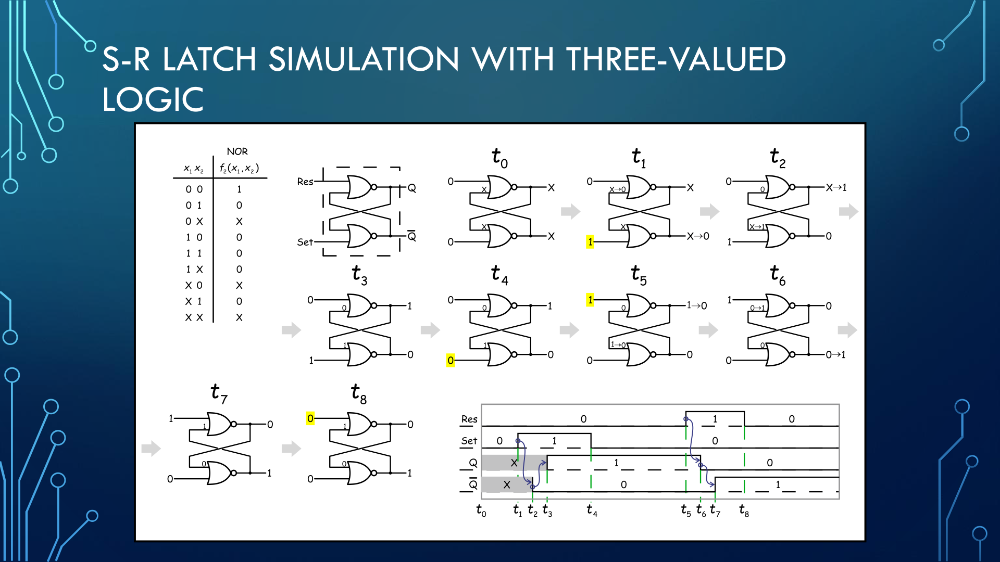
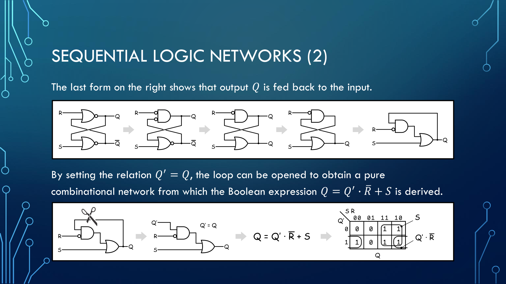

# HDL PID 

## Informational documents for a course on logic networks, HDLs and programmable logic arrays (FPGAs).

This presentation was used at two informational meetings (a two-part seminar) on behalf of the San Marino Association of Professionals for Digital Innovation (PID).

The seminar's purpose was to acquaint people who work primarily with software with the way modern digital systems are defined and described.

The presentation consisted of slides that supported a spoken description held directly by the authors. The presentation was in Italian.

It takes place in three parts: the first two are carried out during the first meeting. The third part, with a more practical aspect, took place during the second meeting.

The first half of the second part shows the development of a very simple preparatory demonstration project. The rest of the meeting shows how to implement a Manchester transceiver running at megabits on an inexpensive and readily available FPGA. 

The device used in the experiments is Sipeed's TangNano 9K.

## Contents

The material is available in two languages, each in its own folder. The English version is a translation of the original Italian slides (including the comments in the code samples).

### Italian (original) — [ITA](ITA/)

| File | Description |
|------|-------------|
| [HDL-Parte1.pptx](ITA/HDL-Parte1.pptx) | Editable PowerPoint source of the first meeting: logic networks, programmable logic, and an introduction to HDLs and Verilog (131 slides). |
| [HDL-Parte1.pdf](ITA/HDL-Parte1.pdf) | PDF export of the slides above. |
| [HDL-Parte2.pptx](ITA/HDL-Parte2.pptx) | Editable PowerPoint source of the second, practical meeting: the TangNano 9K kit, a shift register demo and the Manchester transceiver (45 slides). |
| [HDL-Parte2.pdf](ITA/HDL-Parte2.pdf) | PDF export of the slides above. |
| [HDL_Code.zip](ITA/HDL_Code.zip) | Verilog sources of the two demo projects (`Shift_Ripple` and `ManchesterComm`), each as a nested zip. |

### English (translation) — [ENG](ENG/)

| File | Description |
|------|-------------|
| [HDL-Part1-EN.pptx](ENG/HDL-Part1-EN.pptx) | English PowerPoint version of Part 1. |
| [HDL-Part1-EN.pdf](ENG/HDL-Part1-EN.pdf) | PDF export of the slides above. |
| [HDL-Part2-EN.pptx](ENG/HDL-Part2-EN.pptx) | English PowerPoint version of Part 2. |
| [HDL-Part2-EN.pdf](ENG/HDL-Part2-EN.pdf) | PDF export of the slides above. |
| [HDL_Code-EN.zip](ENG/HDL_Code-EN.zip) | Same code as the Italian archive, with the Italian comment translated. |

> **Note:** the text of the slides is translated, but some figures are bitmaps with embedded Italian labels (for example some diagrams, truth-table boxes and oscilloscope captions). Those labels are still in Italian in the English version.

### Examples from the English slides

The following examples illustrate the visual style and explanatory approach used in the English presentation.

*A step-by-step simulation of an S-R latch, paired with a timing diagram to connect the circuit's behavior to its signal transitions.*

*A sequence of circuit transformations shows how feedback in a sequential network can be opened to derive its Boolean expression.*
